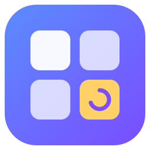
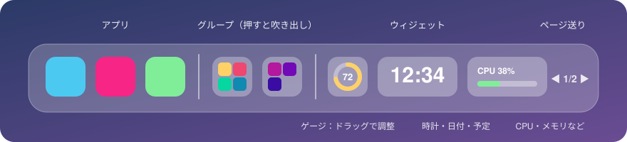
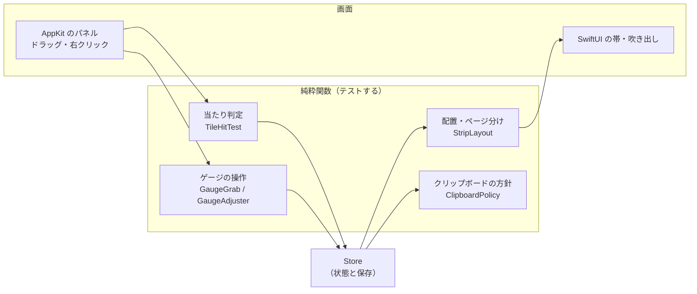

<p align="center">
  
</p>

<h1 align="center">GroupDock</h1>

<p align="center">
  macOS の Dock 代替。画面の端に浮かぶ帯に、アプリをグループにまとめて並べ、ウィジェットも置けます。
</p>

<p align="center">
  
  
  
  
</p>

<p align="center">
  
</p>

## 特長

| | 機能 | 内容 |
| --- | --- | --- |
| 🗂 | **グループ** | アプリを名前つきのグループにまとめ、タイルを押すと吹き出しで開く。グループ丸ごとの起動・終了ができる。名前はダブルクリックで直接編集 |
| 🧩 | **ウィジェット** | 時計・日付・予定・バッテリー・CPU・メモリ・ディスク・推移・再生中・音量・マイク・明るさ・クリップボード履歴。外部 JSON で足せる（[docs/widgets.md](docs/widgets.md)） |
| 🎚 | **ゲージの操作** | 音量・マイク・明るさのゲージは、詳細を開かずに、ホイールかドラッグで調整できる（外周を掴むと並べ替え） |
| 🔊 | **音量・マイク** | デバイスの切り替えと固定。固定は macOS の既定まで固定先へ戻す。つないでいない機器（AirPods など）も候補に出せる |
| 📋 | **クリップボード履歴** | 暗号化して保存。パスワード管理アプリからのコピーと、秘密に見える内容は記録しない。保存期間を選べる（既定 7 日） |
| 📐 | **配置** | 下・左・右、自動で隠す、複数ディスプレイ。収まらないときは、ページ切り替え（大きさを保つ）か縮小を選べる |
| 🗑 | **ゴミ箱** | 右クリックで「開く」「空にする」 |
| 🛡 | **扱い** | 二重起動しない。Mac 起動時に自動で起動（設定で切り替え）。終了時に標準 Dock を戻す |

## 動作環境

macOS 14 以降。ビルドは実行中の CPU 向け（`uname -m`）。

## 配布版のインストール

[Releases](../../releases) から `GroupDock.zip` を取り、`GroupDock.app` を `/Applications` へ置きます。
配布版は **ad-hoc 署名（公証なし）** です。初回は、Finder で右クリック →「開く」、または次を実行してください。

```sh
xattr -dr com.apple.quarantine /Applications/GroupDock.app
```

## ビルド

```sh
./build.sh          # dist/GroupDock.app（ビルドのたびにバージョンが上がる）
./install.sh        # ビルドして /Applications に反映し、起動し直す
./tests/run.sh      # ロジックのテスト（末尾が ALL OK なら成功）
```

バージョンは `VERSION`（例 `0.2`）と `BUILD_NUMBER`（自動で増える）から決まり、設定 › 一般 に表示されます。
検証だけで番号を上げたくないときは `NO_BUMP=1 ./build.sh`。

## 作りの方針

配置・当たり判定・ページ分け・保存の判定は、画面から切り離した**純粋関数**にして、画面なしでテストします。
画面（SwiftUI／AppKit）は、その結果を置くだけです。



詳しくは [docs/architecture.md](docs/architecture.md) と [docs/design-review.md](docs/design-review.md)。

## 必要な許可

| 許可 | 目的 |
| --- | --- |
| アクセシビリティ | 標準 Dock の未読バッジの読み取りのみ |
| オートメーション | 再生中（ミュージック・Spotify・ブラウザ）、ゴミ箱を空にする（Finder） |
| カレンダー | 予定ウィジェット |
| Bluetooth（任意） | 音量・マイクの候補に、ペアリング済みの機器を出す。ボタンを押したときだけ求める |

ブラウザの再生の音量・シークには、ブラウザ側の「Apple Events からの JavaScript を許可」が要ります。

## 内部 API について

次の 2 つだけ、private framework を `dlopen` で読みます（無ければ「使えない」にして落ちません）。通信はしません。

- 再生中：MediaRemote（再生情報の読み取りと、再生・停止・次・前）
- 明るさ：DisplayServices（ディスプレイの明るさの取得・設定）

## ドキュメント

- [docs/architecture.md](docs/architecture.md)：構成と最適化の記録
- [docs/widgets.md](docs/widgets.md)：外部ウィジェットの仕様
- [docs/design-review.md](docs/design-review.md)：設計の見直しの記録
- [SECURITY.md](SECURITY.md)：保存先・権限・扱うデータ

## ライセンス

[MIT](LICENSE)
